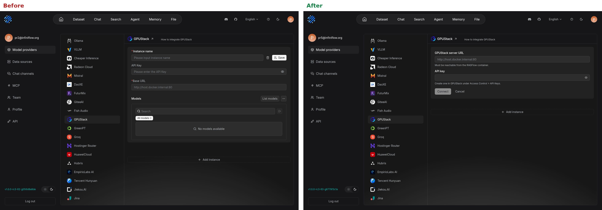
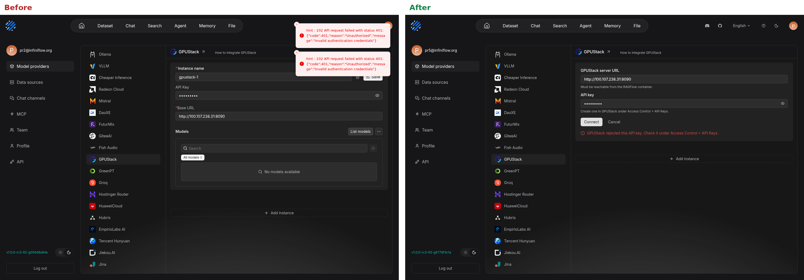
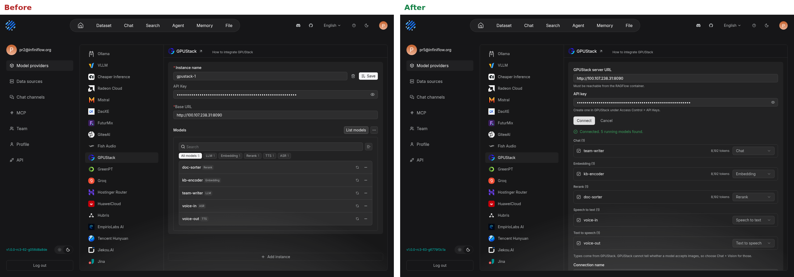
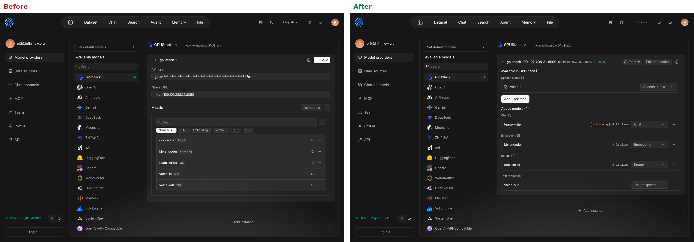

Screenshots of the GPUStack provider setup rework on [feat/gpustack-adaptation](https://github.com/foyoux/ragflow/tree/feat/gpustack-adaptation). Left is the existing form, right is the new GPUStack card.

## New connection

## Wrong API key

## Models discovered

## Saved connection: new and stopped models

