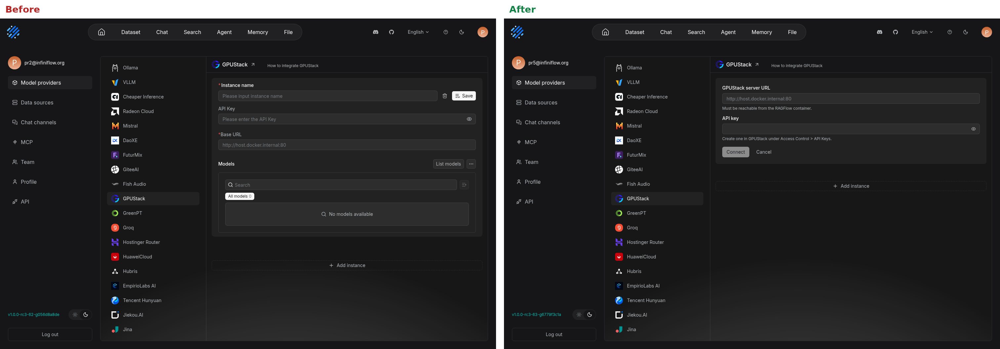
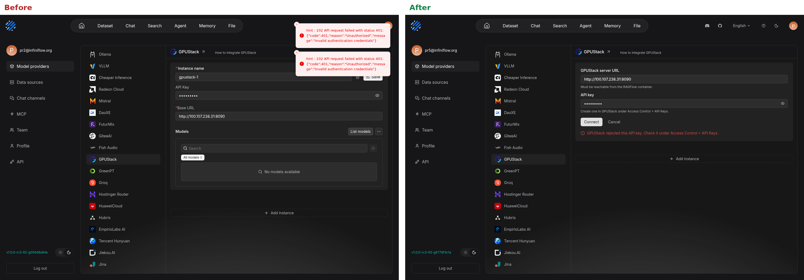
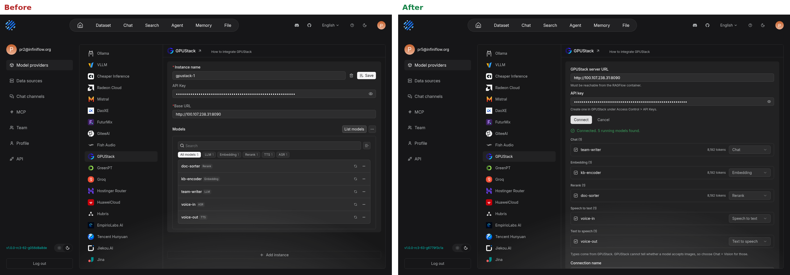
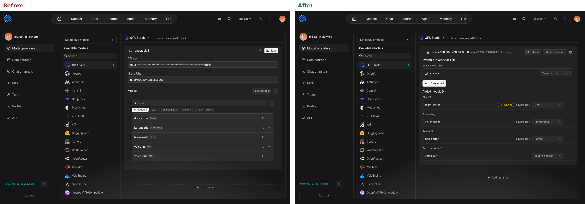

### Summary

Rework the GPUStack provider setup around what a GPUStack server already knows, and fix the driver issues found by running against a real GPUStack v2.3 deployment.

A GPUStack server knows which models it runs and what they are, but setting one up meant naming an "instance", filling in credentials, listing models, and saving, with failures reported as a raw toast. This adds a dedicated instance card, using the same dispatch as `BedrockInstanceCard`. Other providers are unaffected.

### Before and after

Left is the existing form, right is the new card.

**New connection**

**Wrong API key**

**Models discovered**

**Saved connection, showing a new model and a stopped model**

| | Before | After |
| --- | --- | --- |
| Instance name | Required before anything else | Generated from the server address, editable before adding |
| Wrong API key | Toast: `hint : 102 API request failed with status 401...` | Inline message saying where to check the key |
| No models | `No models available` | Explains that models must be running with a route, links the guide |
| `localhost` URL | No warning | Warns that it points at the RAGFlow container |
| Model list | Flat list with tag filters | Grouped by type, with checkboxes, type selector and context length |
| Saved connection | Re-list to see what the server has | Refreshes on open, shows new models and models that stopped running |
| "How to integrate" link | GPUStack quickstart | GPUStack's RAGFlow integration guide |
| API key on discovery | Sent in the URL query string for unsaved instances | Sent in the request body |

### Changes

**Web**
- Add `GPUStackInstanceCard` and its helpers.
- Point the provider doc link at the integration guide.

**API**
- Add `POST /api/v1/providers/:provider/models/discovery`, which takes the credential in the body. The existing `GET` is unchanged, so other providers still send keys in the URL when listing models for an unsaved instance. That deserves its own change.

**GPUStack driver**
- Use GPUStack's categories for model types instead of guessing from route names. `llm` alone does not override a more specific name, because GPUStack uses it as the default for unknown architectures.
- Treat models that declare voices as TTS.
- Fill the context length from `meta.max_model_len`.
- Default to the model's first declared voice. Chat read-aloud sends none and VoxBox requires one, so read-aloud always failed with a 422.
- Treat an error status in a 200 response as a failure. VoxBox returns `HTTPException` objects rather than raising them, so failed transcriptions looked like success with empty text.
- Record the usage GPUStack reports for embeddings.
- Report the underlying error when listing models fails during verification, instead of `no models found for provider`. This code is shared, so other providers get the clearer message too.

### Testing

Run end to end with GPUStack v2.3.0 on an RTX 5090 D:

- vLLM: discovery, ingestion, retrieval with rerank, streaming knowledge chat, image chat
- SGLang: discovery, streaming knowledge chat
- VoxBox: chat read-aloud, voice input, with TTS output transcribed back to the same text
- llama.cpp on CPU: full flow, on an earlier build of the driver changes
- New card, driven in a browser: wrong key, empty result, add, change type, remove, edit connection, stopped model, and an instance created with the old form

Unit tests: `internal/entity/models` and the new web tests pass.

Not covered:
- `internal/service` unit tests, which did not link locally (`pdf_oxide`). The package compiles in the image build.
- Tool calling through an Agent. Only the backends were checked directly.
- SGLang and image chat were last run before the UI change. It does not touch the chat path.
- The Chinese strings were not checked on screen.
- `local-llm-configs.test.ts` has one failing FunASR test, which also fails without this change.

### Known limits

- GPUStack does not say whether a model accepts images, so vision models must be set to Chat + Vision by hand. The card says so.
- Default models are still set separately under "Set default models".
